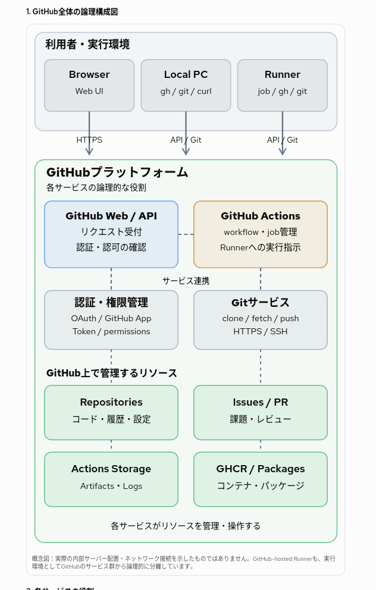
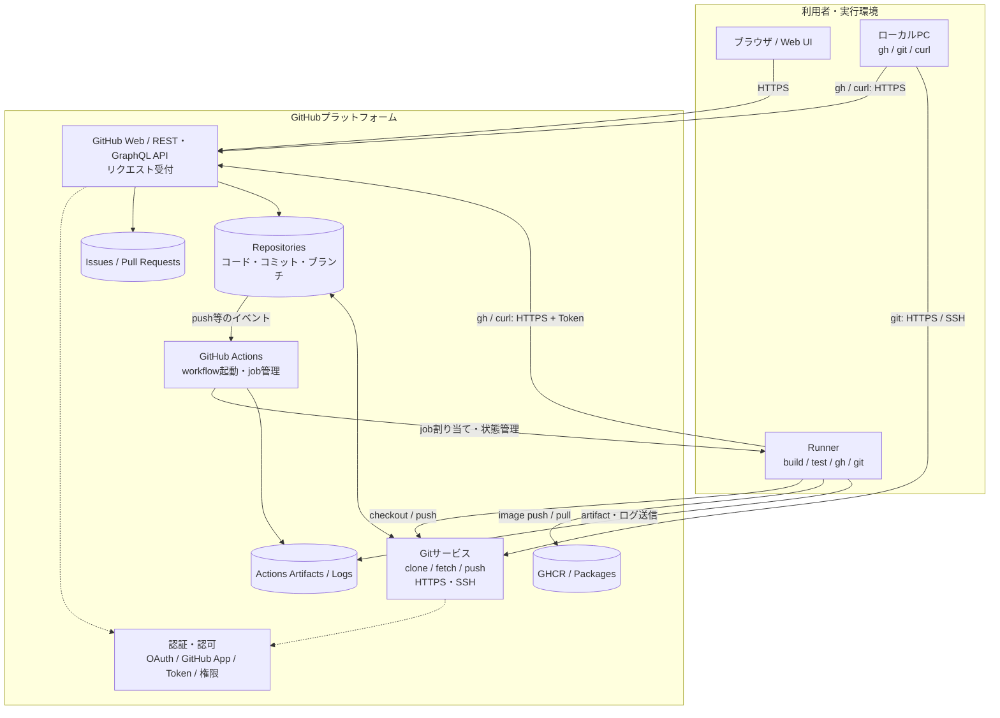
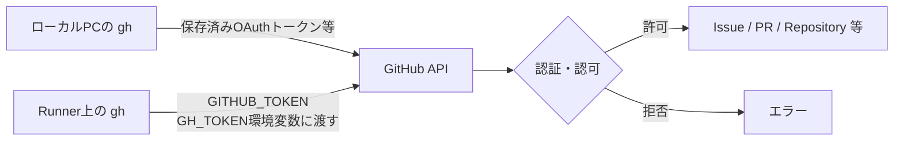
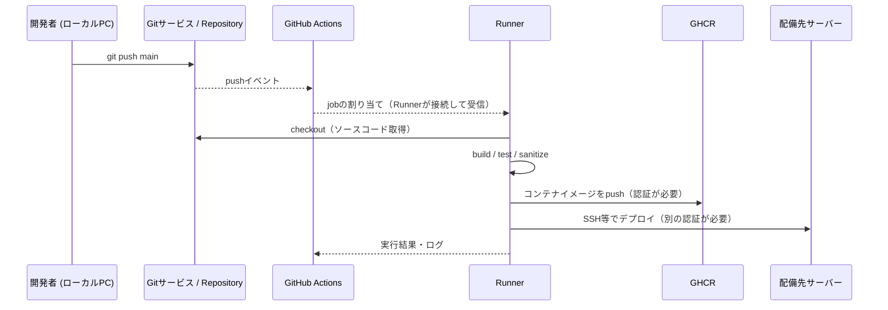

# GitHubプラットフォームの論理アーキテクチャ

GitHubを単一のサービスではなく、**GitHub Web/API・Gitサービス・リポジトリ・GitHub Actions・Runner・認証/認可・GHCR**が連携するシステムとして理解するための学習ノートです。

> この図は役割と通信経路の**論理モデル**です。GitHubの内部サーバー配置、データベース、マイクロサービス境界を示す公式構成図ではありません。

## 1. 全体の論理構成





※ 矢印は代表的な論理的関係です。実装内部の一方向の通信や物理配置を断定するものではありません。特にActionsとRunner間のjob受け渡しは、RunnerがGitHub側に接続してjobを受け取る仕組みであり、GitHubがRunnerへ直接SSHしてコマンドを実行するわけではありません。

## 2. 主要コンポーネントの役割

| コンポーネント | 主な責務 | 例 |
|---|---|---|
| GitHub Web / API | Web UIやAPIリクエストを受け付ける | `gh issue list`, REST API |
| Gitサービス | Gitプロトコルでコードの履歴を送受信 | `git clone`, `git push` |
| Repositories | ソースコード、コミット、ブランチ、設定などの管理対象 | `main`, `.github/workflows/ci.yml` |
| Issues / Pull Requests | 課題、変更提案、レビュー | Issue作成、PRレビュー |
| GitHub Actions | イベントをもとにworkflowを起動しjobを管理 | pushでCIを開始 |
| Runner | jobのコマンドを実際に実行する計算環境 | `gcc`, `make`, `pytest` |
| 認証・認可 | アクセス主体と許可された操作を確認 | OAuth、GitHub App、`GITHUB_TOKEN` |
| GHCR / Packages | コンテナイメージなどの保管・配布 | `docker push ghcr.io/...` |
| Actions Storage | 実行ログやArtifactsを保存 | ビルド成果物アップロード |

## 3. `gh` と GitHub API、認証情報

ローカルの`gh`もRunner上の`gh`も、主にGitHub APIにリクエストします。違いは**認証情報の入手方法と権限**です。



- **Identification（識別）**：どの主体かを名乗る。
- **Authentication（認証）**：認証情報を検証して主体を確認する。
- **Authorization（認可）**：その主体に要求された操作を許可するか判断する。
- `GITHUB_TOKEN`はjobごとにGitHubが自動発行する、GitHub Actions向けのGitHub Appインストールアクセストークンです。基本的にはworkflowがあるリポジトリを対象とし、権限は実行イベントや設定にも左右されます。
- `permissions`でトークンに必要最小限の権限を与えます。`permissions`はラベルではなくworkflow/jobの**設定キー**です。
- 公開リソースへの一部アクセスは認証なしでも可能です。

```yaml
jobs:
  inspect:
    runs-on: ubuntu-latest
    permissions:
      issues: read
    steps:
      - name: List issues through GitHub API
        env:
          GH_TOKEN: ${{ github.token }}
        run: gh issue list --repo "${{ github.repository }}"
```

ローカルでは通常 `gh auth login` で認証情報を取得・保存し、`gh auth status` で確認します。どちらもAPIリクエスト時にトークン等の認証情報を提示します。

## 4. RunnerにあるリソースとGitHub側のリソース

**Runner側**にはCPU、メモリ、ディスク、コンパイラ、チェックアウトしたコードのコピーが存在します。`gcc`やテストはRunnerの計算資源で実行します。

**GitHub側**にはリポジトリの原本、Issues、PR、Actionsの実行履歴、Artifacts、GHCRなどがあります。Runnerがそれらにアクセスする際は、目的に応じてGitHub API、Git通信、レジストリAPI等を使います。**すべてがGitHub REST APIを経由するわけではありません。**

## 5. PushからCI/CDまでの処理の流れ



### 認証の使い分け

| 操作 | 代表的な認証方式 |
|---|---|
| ローカルで `gh issue list` | `gh auth login`で取得・保存した認証情報 |
| Actionsで `gh api` | `GITHUB_TOKEN` を `GH_TOKEN` に渡す |
| ActionsでGHCRへpush | `GITHUB_TOKEN` と `packages: write` 等 |
| Runnerから配備先へSSH | SSH鍵、SSH証明書等（`GITHUB_TOKEN`ではない） |
| `gcc`でビルド / ローカルでテスト | GitHubへの認証は不要 |

## 6. GitHub Appの位置づけ

GitHub Appは**GitHubにアプリケーションとしてアクセスするための登録・インストール・権限・認証の仕組み**です。「インストール」は通常、PCにプログラムを入れることではなく、アプリに対象アカウントやリポジトリへのアクセスを許可することを指します。

`gh`がGitHub APIを呼び出すとき、GitHub Appが独立したプロキシサーバーとして毎回リクエストを受けるわけではありません。GitHub API側がトークンと権限を検証します。自作のGitHub Appなら、そのアプリの処理本体を外部サーバーに置くこともできます。

## 7. セキュリティ上の要点

- PR時のテストと、mainへのマージ後の公開・デプロイを分離する。
- `GITHUB_TOKEN`の`permissions`は最小限にする。
- forkからのPRなど、イベントによりトークンやSecretsの扱いが変わることを理解する。
- `pull_request_target`で信頼できないPRのコードを実行しない。
- PRレビューは自動で必須になるわけではないため、branch protectionやrulesetを適切に設定する。
- GitHub-hosted Runnerとself-hosted RunnerのいずれもGitHub側のリソースには通信でアクセスする。ただしself-hosted RunnerのOS管理などは利用者側の責任となる。

## 8. 覚えておく3つの問い

1. **制御するのは誰か？** ― GitHub Actionsがworkflowやjobを管理する。
2. **実際に処理するのは誰か？** ― Runnerがビルドやテストを実行する。
3. **データはどこに存在するか？** ― GitHub側の原本とRunner上のコピーを区別する。

これらはあくまで論理上の役割区分です。GitHub内部の実装がこの図どおりの単一サービス・単一サーバーで構成されているという意味ではありません。

## 参考資料

- [GitHub Actionsについて](https://docs.github.com/ja/actions/about-github-actions/understanding-github-actions)
- [GITHUB_TOKENによる認証](https://docs.github.com/ja/actions/security-for-github-actions/security-guides/automatic-token-authentication)
- [GitHub Appについて](https://docs.github.com/ja/apps/creating-github-apps/about-creating-github-apps/about-creating-github-apps)
- [GitHub REST API](https://docs.github.com/ja/rest)
